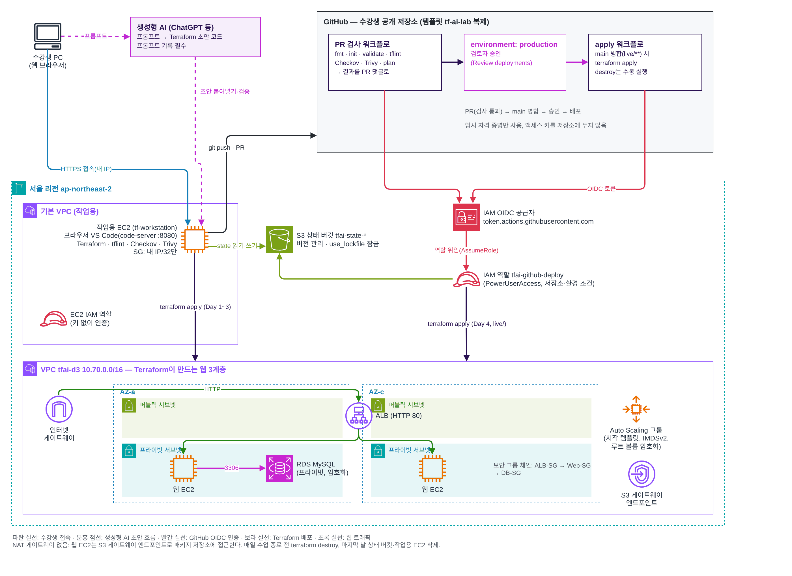

# 결과 보고서 — (이름)

## 1. 선택한 요구사항 카드
- 카드: A 정적 웹사이트 / B 모듈화된 웹 서버 (하나 남기기)
- 배포 주소:

## 2. 구성도
(draw.io로 그린 그림을 docs/ 에 PNG로 저장하고 아래에 넣기)

## 3. 파이프라인
- PR 번호와 plan 코멘트 링크:
- 승인 후 apply 실행 링크:
- 검사가 막은 위험 변경 PR 링크와 막은 도구·검사 ID:

## 4. 프롬프트 기록 요약
| 일차 | 요청 | AI 결함 | 찾은 방법 | 수정 |
| --- | --- | --- | --- | --- |

## 5. 검사 결과
- tflint:
- Checkov: Passed / Failed / Skipped
- Trivy HIGH·CRITICAL:
- 예외로 둔 항목과 이유:

## 6. 배운 점과 다음에 바꿀 프롬프트
-
